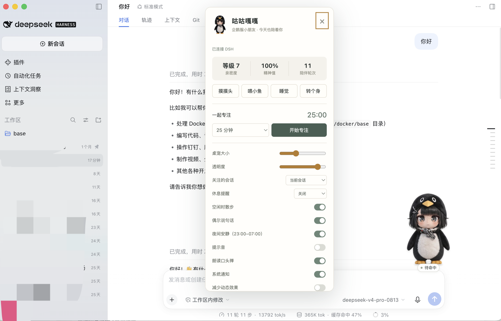

# 咕咕嘎嘎

DeepSeek Harness 的第三方企鹅服桌宠插件。跟着工作状态变化，也会摸头撒娇、吃小鱼、闭眼睡觉，嘴里念叨着「咕咕嘎嘎」「我里个嘎嘎」。

[快速安装](#快速安装) · [功能](#功能) · [自定义台词](#自定义台词) · [DSH 插件规范](#dsh-插件规范) · [开发](docs/DEVELOPMENT.md)


支持 **DSH Web 与桌面客户端内悬浮**。角色与设置面板可以分别拖动、分别记住位置。



*DSH 桌面客户端实机截图，由维护者提供并完成脱敏。*

## 实际效果

以下截图来自仓库提供的交互预览，展示实际插件 UI。预览中的会话状态由演示按钮驱动；安装到 DSH 后由宿主提供真实状态。

### 独立面板与睡眠

设置面板移到左侧时，桌宠可以单独放在右侧。手动睡觉后保持闭眼，直到叫醒或主动摸头、喂食。


### 自定义台词

选择场景、填写自己的台词并保存；「试说一句」立即预览气泡，开启朗读后使用系统语音。


### 角色表情

从左到右：微笑、开心、满足、闭眼睡眠。微笑与开心保留角色的大眼睛和肤色渐变。


## 功能

| 功能 | 行为 |
| --- | --- |
| 工作陪伴 | 展示空闲、工作、待确认、本轮结束和断线；可关注当前会话或全部会话 |
| 互动养成 | 摸头、喂小鱼、转身、亲密度与精神值；连续互动有冷却 |
| 独立拖动 | 角色与面板互不带动；分别保存位置，窗口缩小后保持可见 |
| 睡眠 | 手动睡觉与空闲打盹，睡眠时完全闭眼，醒来恢复原表情 |
| 台词 | 按场景编辑多句台词，保存、轮换、试说；支持系统语音朗读 |
| 专注与休息 | 15 / 25 / 45 / 60 分钟专注计时；可选 30 / 60 / 90 分钟休息提醒 |
| 外观与打扰控制 | 大小、透明度、散步、碎碎念、夜间安静、减少动态、隐藏与叫回 |
| 可选通知 | 本轮结束、待确认和计时到期提醒；提示音、语音与系统通知默认关闭 |

「本轮结束」表示 DSH 的 `running` 状态结束，也可能包含用户取消，不能据此判断任务成功。插件只提醒，不代替用户处理审批。

## 快速安装

### 前置条件

- 使用 DeepSeek Harness 的 Web 界面或桌面客户端；本插件在应用窗口内悬浮。
- 插件在 `package.json` 顶层声明 `engines.dsh: ">=0.2.2-rc.5"`，接口适配基线为 `0.2.2-rc.5`。该范围是兼容性声明，实际验收范围见[验证记录](docs/validation.md)。
- DSH 处于开发者预览阶段，升级可能改变接口；安装时由宿主检查版本要求。

**桌面端**：先安装并启动一次 DeepSeek Harness 桌面客户端，再使用应用内的「插件」页。桌面版自带运行时，安装本插件不要求额外安装 Node.js。终端入口说明见[官方桌面文档][official-desktop-cli]。

**Web 端**：按[官方运行说明][official-readme]启动：

```bash
npx @deepseek-ai/dsh web
```

默认访问地址为 `http://127.0.0.1:3080`，以命令实际输出为准。Node.js 必须满足所用 DSH 发行版的要求；本次核对的[官方 CLI 清单][official-cli-package]（`0.2.3-alpha.2`）声明 `^24.22.3 || >=26.13.1`。本仓库开发用的 Node.js 22 下限不代表宿主的最低要求。

### 获取插件

仓库包含可直接加载的 `lib/client.js`，普通安装不需要执行 `npm install` 或构建：

```bash
git clone https://github.com/zealerFT/dsh-gugugaga.git
cd dsh-gugugaga
```

下面的终端示例使用 macOS / Linux shell。Windows 用户可通过应用内插件页填写克隆目录的完整路径。

### 安装到桌面端

推荐在桌面客户端「插件」页的安装入口填写仓库的**绝对路径**，确认安装并启用。该路径必须位于运行 DSH 的机器上；按宿主提示刷新界面或重启应用。

使用终端时，先在桌面应用菜单 **管理 dsh 命令…** 中安装命令，打开新终端，用 `dsh --version` 核对版本。按[官方内置命令要求][official-desktop-runtime]，首次启动完成初始化后，**完全退出桌面应用**，再在插件仓库目录运行：

```bash
dsh plugin --profile desktop add "$PWD"
```

完成后重新打开桌面客户端。这里的 `dsh` 必须来自桌面版；**npm / npx 版 CLI 会拒绝管理 `desktop` profile**，具体边界见[官方 CLI 说明][official-cli]。

### 安装到 Web 端

先启动过一次 Web 界面，再在插件仓库目录的另一个终端运行：

```bash
npx @deepseek-ai/dsh plugin --profile web add "$PWD"
```

若已有与正在运行的 Web 宿主相同版本的 `dsh` 命令，也可以使用：

```bash
dsh plugin --profile web add "$PWD"
```

安装与启动应使用同一 DSH 版本；使用固定版本时，两条 `npx` 命令都写成 `npx @deepseek-ai/dsh@<版本> ...`。使用自定义 profile 时，将 `web` 换成实际名称。

Web 界面也支持在「插件」页填写绝对路径安装；远程部署时填写服务器上的路径。独立下载 `.tgz` 后，也可用包的绝对路径代替目录。宿主支持本地目录、tarball、Git 和 npm 来源，规则见[官方插件管理器][official-plugin-manager]。

### 更新与移除

在克隆目录运行 `git pull --ff-only`。目录链接安装需要按宿主提示重载；复制目录或 `.tgz` 安装需要重新安装更新后的包。若应用内入口提示已安装，可在「插件」页移除后重新添加该目录；桌宠保存在浏览器中的偏好不会随卸载清除。桌面终端安装仍需先退出应用。停用和移除均在对应 profile 操作。

## DSH 插件规范

本项目使用官方支持的 **Cordis 插件 + bundle patch + Web client module** 机制，属于第三方插件。官方文档定义了加载接口和第三方插件索引；索引由发布者维护，DSH 不验证其中的作者声明，因此可安装或被收录不代表 DeepSeek 官方认证。

以下规则按官方仓库提交 [`4b399c3`](https://github.com/deepseek-ai/deepseek-harness/tree/4b399c39a6d1479cd84ca591b4d7c88e24d38a96) 核对（2026-11-24）：

| 项目 | 官方约定与本插件实现 |
| --- | --- |
| 包身份与入口 | `package.json` 提供 `name`、`version` 与可解析的运行时入口；本插件通过 `index.js` 导出 Cordis `apply()`。 |
| 可安装组合包 | 插件管理器安装的包需声明 `dsh.bundle.patch`；本插件指向随包提供的 `cordis.patch.yml`，由其加载 `dsh-gugugaga-pet`。 |
| 宿主兼容性 | 顶层 `engines.dsh` 使用 SemVer 范围，与 `engines.node` 并列；缺省时才回退到 DSH peer 依赖检查。范围匹配包含预发布版本。 |
| 浏览器模块 | 声明 `dsh.client.platform: "web"` 和 `exports["./client"]`，并随包提供构建产物；本插件通过 `window.__ModuleLoader__.load({ id, factory })` 注册，`id` 与包名一致。 |
| 依赖与生命周期 | `dsh.client.inject` 声明客户端包依赖，模块中的 `inject` 声明 Cordis 服务依赖；本插件依赖 `uiSession`、`connection`，用 `ctx.effect` 挂载并清理资源。 |
| 展示元信息（可选） | 标题和描述位于 `locale/en.json`、`locale/zh.json` 的 `meta` 中；通过 `exports` 暴露 locale 文件，并纳入 `files`。 |

加载规范见[官方 App boot][official-app-boot]、[Client 模块][official-client-modules]和[插件展示元信息][official-display-meta]。官方 monorepo 的 workspace 目录、统一版本、TypeScript 构建与仓库 CI 约定，适用于向该仓库贡献包，不应全部套作外部插件的安装条件。

### 分发与索引收录

当前通过公开 Git 仓库、本地目录和 `.tgz` 分发，未发布 npm 包。`package.json` 保留 `private: true`，可用于本地安装，但会被[官方参考索引生成器][official-market]跳过。

若要供第三方索引收录，需要满足其分发条件：

- 使用官方参考生成器时，包须声明 `dsh.bundle`，且不能设置 `private: true`；npm 来源还需有已发布、未弃用的版本。
- 索引版本使用精确 SemVer；Git 来源使用 HTTPS 仓库地址和完整的 40 位 commit SHA，可指定包所在子目录。索引中的 `engines.dsh` 应与包清单一致。
- DSH 不内置任何索引源，用户需添加索引 URL。官方建议为 GitHub 仓库添加 `dsh-plugin` topic，方便发现；该 topic 是发现标签。

包源码与角色素材的许可状态应分别说明，现有素材记录见[素材说明](docs/ARTWORK.md)。

## 使用方法

| 操作 | 效果 |
| --- | --- |
| 点击桌宠 | 摸摸头，显示爱心和回应 |
| 拖动桌宠 | 移动角色并保存位置 |
| 右键桌宠 / 工具条菜单 | 打开陪伴设置 |
| 拖动面板标题栏 | 单独移动设置面板 |
| 聚焦面板标题后按方向键 | 移动面板；按住 Shift 加快移动 |
| 「睡觉 / 叫醒」 | 切换闭眼睡眠与清醒状态 |
| 「转个身」 | 展示企鹅背影与小尾巴 |
| 「暂时隐藏」 | 收到右下角「嘎」按钮，点击叫回 |
| Esc | 收起设置面板 |

### 自定义台词

1. 打开设置，展开 **自定义台词**。
2. 选择空闲、摸头、喂食、睡觉、工作、专注等场景。
3. 每行填写一句，点击 **保存台词** 或 **试说一句**。

每个场景最多 20 句，每句最多 120 字；留空使用默认台词。重置偏好保留自定义台词。当前使用系统语音朗读文字，尚未提供录音导入或音色克隆。

## 本地预览与开发

需要 Node.js 22 或更新版本。

```bash
npm ci --ignore-scripts
npm run check
npm run preview
```

预览命令输出本机地址。构建还会生成可直接打开的单文件 `dist/gugugaga-preview.html`。

运行 `npm run pack:local` 生成 `dist/dsh-gugugaga-pet-1.0.0.tgz`，用于本地安装或离线传递。更多说明见 [开发指南](docs/DEVELOPMENT.md)、[验证记录](docs/validation.md) 与 [变更记录](CHANGELOG.md)。

## 数据与权限

- 插件运行时没有第三方依赖、外部模型请求或遥测，不读取凭据、会话正文和标题。
- 偏好、两组坐标、自定义台词、互动数据和计时存于当前浏览器的 `dsh-gugugaga-pet:v1`；不同 origin 的数据独立。
- 卸载插件不会自动清除浏览器偏好。系统语音和通知取决于浏览器、操作系统及授权状态。
- 停用时清理 DOM、订阅、定时器、通知和音频资源。

## 常见问题

**安装后没有出现？** 确认安装到正在使用的 profile：桌面客户端用 `desktop`，Web 默认用 `web`。桌面端优先使用应用内插件页；终端安装需要桌面版提供的 `dsh`。按宿主提示刷新或重启，并检查版本兼容性与插件启用状态。

**提示版本不兼容？** 核对实际宿主版本与 `package.json` 顶层 `engines.dsh`，并使用兼容版本。兼容性检查通过表示版本声明匹配，具体功能验收范围见[验证记录](docs/validation.md)。

**显示尚未连接？** 独立预览使用演示状态。真实 DSH 中出现此提示时，检查宿主连接和客户端接口兼容性。

**没有声音或通知？** 在设置中开启相应选项，再检查系统授权。自动提醒还会受夜间安静和睡眠状态影响。

**台词或位置没有保存？** 浏览器可能禁用了存储或已达到容量限制，面板会显示提示；当前会话仍可继续互动。

## 参考与素材

交互范围参考 [dsh-pet](https://github.com/PC2005-cloud/dsh-pet) 的公开功能说明；实现和角色素材独立维护。角色源图、处理方法及授权状态见 [素材说明](docs/ARTWORK.md)。

[official-readme]: https://github.com/deepseek-ai/deepseek-harness/blob/4b399c39a6d1479cd84ca591b4d7c88e24d38a96/README.zh.md#run
[official-cli]: https://github.com/deepseek-ai/deepseek-harness/blob/4b399c39a6d1479cd84ca591b4d7c88e24d38a96/apps/cli/README.zh.md
[official-cli-package]: https://github.com/deepseek-ai/deepseek-harness/blob/4b399c39a6d1479cd84ca591b4d7c88e24d38a96/apps/cli/package.json
[official-desktop-cli]: https://github.com/deepseek-ai/deepseek-harness/blob/4b399c39a6d1479cd84ca591b4d7c88e24d38a96/apps/desktop/README.zh.md#终端命令
[official-desktop-runtime]: https://github.com/deepseek-ai/deepseek-harness/blob/4b399c39a6d1479cd84ca591b4d7c88e24d38a96/apps/desktop/README.zh.md#bundled-command-runtime
[official-plugin-manager]: https://github.com/deepseek-ai/deepseek-harness/blob/4b399c39a6d1479cd84ca591b4d7c88e24d38a96/packages/boot/plugin-manager/README.zh.md
[official-app-boot]: https://github.com/deepseek-ai/deepseek-harness/blob/4b399c39a6d1479cd84ca591b4d7c88e24d38a96/packages/boot/app-boot/README.zh.md#profiles
[official-client-modules]: https://github.com/deepseek-ai/deepseek-harness/blob/4b399c39a6d1479cd84ca591b4d7c88e24d38a96/docs/subsystems/client-modules.zh.md
[official-display-meta]: https://github.com/deepseek-ai/deepseek-harness/blob/4b399c39a6d1479cd84ca591b4d7c88e24d38a96/docs/cookbook/adding-a-package.zh.md#plugin-display-metadata
[official-market]: https://github.com/deepseek-ai/deepseek-harness/blob/4b399c39a6d1479cd84ca591b4d7c88e24d38a96/docs/user/guide/plugin-market.zh.md
