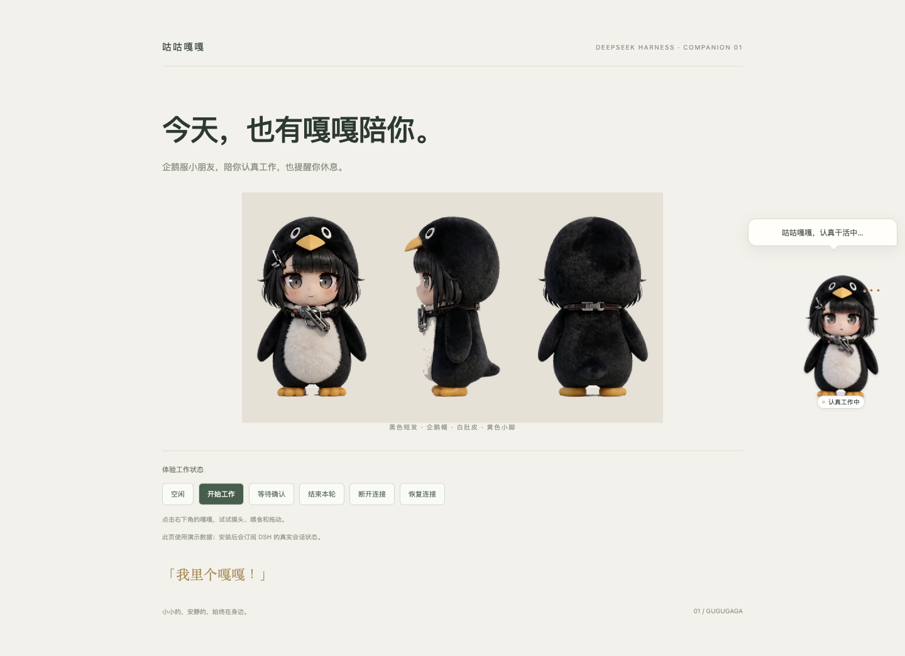
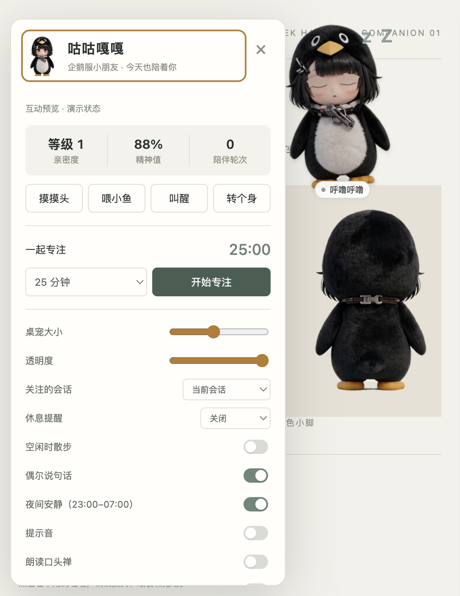
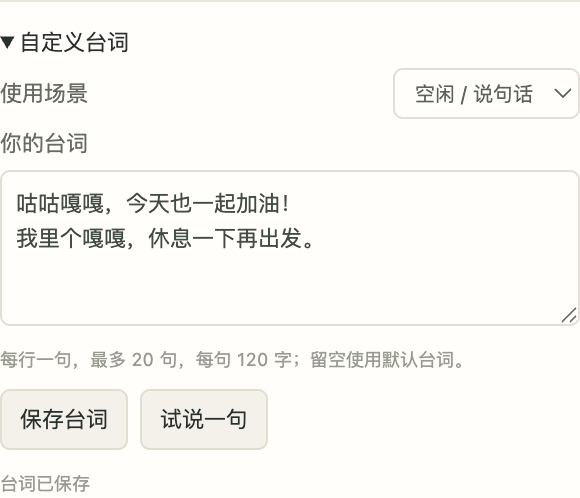

# 咕咕嘎嘎

DeepSeek Harness 的企鹅服桌宠。跟着工作状态变化，也会摸头撒娇、吃小鱼、闭眼睡觉，嘴里念叨着「咕咕嘎嘎」「我里个嘎嘎」。

[快速安装](#快速安装) · [功能](#功能) · [自定义台词](#自定义台词) · [开发](docs/DEVELOPMENT.md)



支持 **DSH Web 与桌面客户端内悬浮**。角色与设置面板可以分别拖动、分别记住位置。

## 实际效果

截图来自仓库提供的交互预览，展示实际插件 UI。预览中的会话状态由演示按钮驱动；安装到 DSH 后由宿主提供真实状态。

### 独立面板与睡眠

设置面板移到左侧时，桌宠可以单独放在右侧。手动睡觉后保持闭眼，直到叫醒或主动摸头、喂食。



### 自定义台词

选择场景、填写自己的台词并保存；「试说一句」立即预览气泡，开启朗读后使用系统语音。



### 角色表情

从左到右：微笑、开心、满足、闭眼睡眠。微笑与开心保留角色的大眼睛和肤色渐变。


## 功能

| 功能 | 行为 |
| --- | --- |
| 工作陪伴 | 展示空闲、工作、待确认、本轮结束和断线；可关注当前会话或全部会话 |
| 互动养成 | 摸头、喂小鱼、转身、亲密度与精神值；连续互动有冷却 |
| 独立拖动 | 角色与面板互不带动；分别保存位置，窗口缩小后保持可见 |
| 睡眠 | 手动睡觉与空闲打盹，睡眠时完全闭眼，醒来恢复原表情 |
| 台词 | 按场景编辑多句台词，保存、轮换、试说；支持系统语音朗读 |
| 专注与休息 | 15 / 25 / 45 / 60 分钟专注计时；可选 30 / 60 / 90 分钟休息提醒 |
| 外观与打扰控制 | 大小、透明度、散步、碎碎念、夜间安静、减少动态、隐藏与叫回 |
| 可选通知 | 本轮结束、待确认和计时到期提醒；提示音、语音与系统通知默认关闭 |

「本轮结束」表示 DSH 的 `running` 状态结束，也可能包含用户取消，不能据此判断任务成功。插件只提醒，不代替用户处理审批。

## 快速安装

### 前置条件

- 已安装 DeepSeek Harness，并能使用 `dsh` 命令。
- 宿主版本为 `0.2.2-rc.5` 或提供兼容客户端接口的版本。
- 使用 Web 界面或桌面客户端。当前形态是窗口内悬浮。

### 从仓库安装

仓库包含可直接加载的 `lib/client.js`，普通安装不需要先构建。

```bash
git clone https://github.com/zealerFT/dsh-gugugaga.git
cd dsh-gugugaga
dsh plugin --profile desktop add "$PWD"
```

使用 `dsh web` 时改为：

```bash
dsh plugin --profile web add "$PWD"
```

也可以在 DSH「插件管理」中填写当前仓库的绝对路径。安装后按宿主提示刷新，或重新打开对应 DSH 界面。

更新时运行 `git pull`，再刷新 DSH；若宿主安装的是复制副本或压缩包，需要重新安装更新后的目录或包。停用、移除均通过 DSH 插件管理完成。

## 使用方法

| 操作 | 效果 |
| --- | --- |
| 点击桌宠 | 摸摸头，显示爱心和回应 |
| 拖动桌宠 | 移动角色并保存位置 |
| 右键桌宠 / 工具条菜单 | 打开陪伴设置 |
| 拖动面板标题栏 | 单独移动设置面板 |
| 聚焦面板标题后按方向键 | 移动面板；按住 Shift 加快移动 |
| 「睡觉 / 叫醒」 | 切换闭眼睡眠与清醒状态 |
| 「转个身」 | 展示企鹅背影与小尾巴 |
| 「暂时隐藏」 | 收到右下角「嘎」按钮，点击叫回 |
| Esc | 收起设置面板 |

### 自定义台词

1. 打开设置，展开 **自定义台词**。
2. 选择空闲、摸头、喂食、睡觉、工作、专注等场景。
3. 每行填写一句，点击 **保存台词** 或 **试说一句**。

每个场景最多 20 句，每句最多 120 字；留空使用默认台词。重置偏好保留自定义台词。当前使用系统语音朗读文字，尚未提供录音导入或音色克隆。

## 本地预览与开发

需要 Node.js 22 或更新版本。

```bash
npm ci --ignore-scripts
npm run check
npm run preview
```

预览命令输出本机地址。构建还会生成可直接打开的单文件 `dist/gugugaga-preview.html`。

运行 `npm run pack:local` 生成 `dist/dsh-gugugaga-pet-1.0.0.tgz`，用于本地安装或离线传递。更多说明见 [开发指南](docs/DEVELOPMENT.md)、[验证记录](docs/validation.md) 与 [变更记录](CHANGELOG.md)。

## 数据与权限

- 插件运行时没有第三方依赖、外部模型请求或遥测，不读取凭据、会话正文和标题。
- 偏好、两组坐标、自定义台词、互动数据和计时存于当前浏览器的 `dsh-gugugaga-pet:v1`；不同 origin 的数据独立。
- 卸载插件不会自动清除浏览器偏好。系统语音和通知取决于浏览器、操作系统及授权状态。
- 停用时清理 DOM、订阅、定时器、通知和音频资源。

## 常见问题

**安装后没有出现？** 确认安装到正在使用的 profile：桌面客户端用 `desktop`，`dsh web` 用 `web`。刷新或重新打开界面，并检查宿主版本是否兼容。

**显示尚未连接？** 独立预览使用演示状态。真实 DSH 中出现此提示时，检查宿主连接和客户端接口兼容性。

**没有声音或通知？** 在设置中开启相应选项，再检查系统授权。自动提醒还会受夜间安静和睡眠状态影响。

**台词或位置没有保存？** 浏览器可能禁用了存储或已达到容量限制，面板会显示提示；当前会话仍可继续互动。

## 参考与素材

交互范围参考 [dsh-pet](https://github.com/PC2005-cloud/dsh-pet) 的公开功能说明；实现和角色素材独立维护。角色源图、处理方法及授权状态见 [素材说明](docs/ARTWORK.md)。
