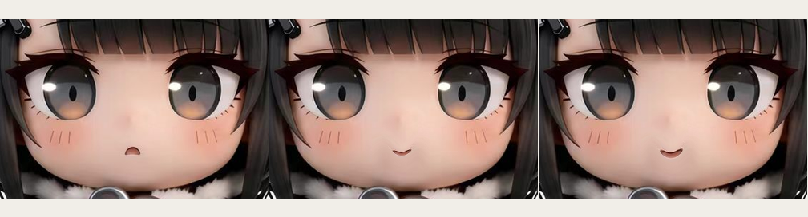
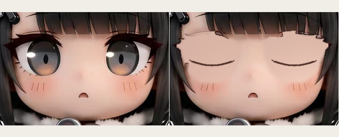

# 素材说明

## 文件来源

`assets/reference.jpg` 是项目维护者提供的企鹅套装小朋友三视图。项目以该图为角色参考，保留黑色短发、银色发夹、企鹅帽、白肚皮、黄色脚和幼态脸型。

源图的原作者、出处链接和授权文本尚未提供。仓库没有把这些角色素材标记为原创或授予额外的图片授权；源码公开也不代表角色素材获得可商用授权。代码与图片的授权应分别确认。

## 处理流程

`scripts/pixelate.py` 使用 Pillow 在本地处理源图，不访问图片生成服务：

1. 统一源图坐标，按正面、侧面、背面裁切。
2. 从边缘识别连通背景，生成透明轮廓。
3. 对嘴部做平滑几何形变，生成微笑、开心与满足表情，保留原图大眼睛。
4. 取原图肤色纹理合成闭合眼睑，保留刘海并绘制细睫毛，生成睡眠和眨眼帧。
5. 统一输出 `224 × 320` RGBA PNG，保留完整色彩与透明边缘。

原图与方法记录见 `assets/provenance.json`。表情素材采用局部编辑，不宣称为逐帧生成的动画。

## 对照图

原图、微笑、开心：

睁眼与完全闭眼：

## 修改要求

- 检查原始尺寸和桌宠实际显示尺寸，避免低分辨率涂色产生突兀色块。
- 微笑和开心保留原图眼睛；睡眠帧完整遮盖虹膜与瞳孔。
- 所有帧使用相同透明轮廓、位置和身体颜色，防止切换时跳动或闪色。
- 只保留渲染必需的图像元数据，避免个人信息进入素材文件。
- 修改后运行 `python3 tests/test_artwork.py`，重新构建并核对实际 UI。
